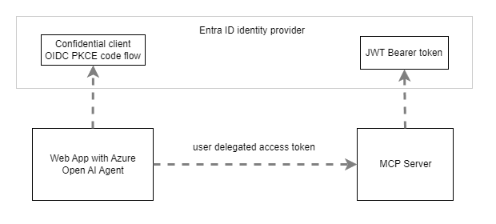
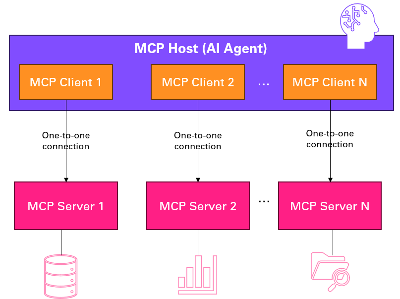
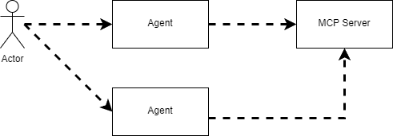
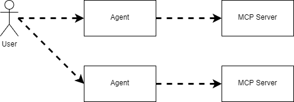

# MCP Security

Model context protocol (MCP) OAuth, security, authorization, authentication flows

## Setup context security



## Blogs

- [Implement a secure MCP server using OAuth and Entra ID](https://damienbod.com/2025/09/23/implement-a-secure-mcp-server-using-oauth-and-entra-id/)
- [Implement a secure MCP OAuth desktop client using OAuth and Entra ID](https://damienbod.com/2025/10/16/implement-a-secure-mcp-oauth-desktop-client-using-oauth-and-entra-id/)
- [Model Context Protocol in .NET](https://medium.com/@cedric.mendelin/model-context-protocol-in-net-06c6076b6385)
- [Model Context Protocol in .Net: Elicitation](https://medium.com/data-science-collective/model-context-protocol-in-net-elicitation-5789dc082895)
- [Developing an MCP Scenario with TypeScript: A production-ready reference implementation, Tobias Maestrini](https://tmaestrini.github.io/topics/developing-an-mcp-scenario-with-typescript-a-production-ready-reference-implementation)
- [Implement a secure MCP server using OAuth DPoP and Duende identity provider](https://damienbod.com/2025/11/03/implement-a-secure-mcp-server-using-oauth-dpop-and-duende-identity-provider/)

## Presentation
- [AI Community Day Zurich - How to securely implement MCP with OAuth in .NET](./slides/AI-community-day-zurich-sept-25/MCP-Security-2025.pdf)
 
## Definitions



- LLM based AI Agent: An AI system that uses tools, prompts, LLMs, and MCPs to discover, reason, and act.
- MCP: A standardized interface for tool and resource integration
- MCP Host: The AI Application which wants to invoke tools on the MCP server.
- MCP Client: An agent-side component that accesses tools via MCP.
- MCP Server: A resource-side implementation of the MCP standard.
- Local Data Source: Locally stored data with built-in authn, authz, trust, and protection.
- Remote Services: Internet-based services with authn, authz, trust, and data protection.
- A2A (Agent-to-Agent): Communication or coordination between agents.
- RAG (Retrieval-Augmented Generation): AI generation enhanced by external data retrieval.
- LLM (Large Language Model): A model trained on vast text data to understand and generate language.
- Generative AI: Reactive AI that produces content based on existing models.
- Agentic AI: Proactive AI that perceives, decides, acts, and learns.
- Vector Database: A database optimized for storing and querying vector embeddings.
- AI Slop: Low-quality or irrelevant output generated by AI tools.

> [!IMPORTANT]  
> S in MCP: The "S" in MCP stands for Security

## MCP flow types

### Simple


### On Behalf Of


### Multi Client



### Multi Client, Multi Server



## Function calling demo (Microsoft.Extensions.AI)

`src/FunctionCallingDemo` shows the function calling settings of MEAI, one demo per launch profile:
`auto-invoke`, `manual-invoke`, `tool-mode`, `parallel`, `max-iterations`, `errors`, `unknown-calls`, `terminate`, `function-invoker`, `approval`, `progressive-discovery` (or `all`).

The `approval` demo requests one tool call at a time so that `get_current_time` can run without approval while `delete_file` requires it. MEAI requires approval for every tool call in a response if any call in that response requires approval; the model provider must honor the single-call request to avoid this.

Configure the Foundry model in the user secrets:

```json
{
  "OpenAI:Endpoint": "https://<your-foundry-resource>.openai.azure.com/",
  "OpenAI:ModelId": "<your-model-deployment-name>",
  "OpenAI:ApiKey": "<your-api-key>"
}
```

Run: `dotnet run --project src/FunctionCallingDemo -- parallel`

Run `dotnet run --project src/FunctionCallingDemo -- progressive-discovery` to compare advertising
102 tools against starting with a keyword-based `search_tools` function and exposing only discovered
tools. The catalog contains 100 simulated administrative functions alongside the weather and time
tools. The comparison sums provider-reported input and output tokens across all requests, including
discovery and tool results, and reports when usage is unavailable. Savings and task completion depend
on the model and its tool choices; discovery adds round trips and does not guarantee a reduction.

## Sales Assistant demo

The Sales Assistant uses the sales MCP tools to explore the seeded customers and
orders. The order data is anchored in May 2025, not a live sales system. Values
are shown in CHF.

| Tool | Purpose |
| --- | --- |
| `get_all_customers`, `get_all_orders` | List the seeded customers or orders. |
| `get_customer_orders`, `get_delayed_orders` | List a customer's orders or orders marked delayed. |
| `search_customers` | Filter by partial name, industry, account manager, and/or tier. |
| `search_orders` | Filter by customer ID, status, inclusive order-date range, and/or CHF value range. |
| `get_customer_overview` | Summarize order counts, total value and delivery delays for a customer. |
| `get_customer_follow_up_notes` | List a customer's simulated notes. |
| `update_order_status` | Change an order's status and actual delivery date. |
| `add_customer_follow_up_note` | Record a simulated note; no message is sent. |

Try asking:

- “Find tier A retail customers and summarize their delayed orders.”
- “Compare Fabrikam GmbH and Helvetic Pharma by total order value and average delivery delay.”
- “Find orders worth at least CHF 30,000 ordered in 2025.”
- “Show me the follow-up notes for Fabrikam GmbH.”
- “Update order ORD-011 to delayed.”
- “Add a follow-up note for Fabrikam GmbH: call about delivery dates.”

Customer-overview averages include only delivered orders marked `Delayed`;
undelivered delayed orders are counted separately. `OnTime` requires an actual
delivery date no later than the promised date; `Delayed` accepts a later actual
date or no date for an undelivered order; `InProgress` requires no actual date.
Actual delivery dates cannot precede order dates.

The web assistant asks for explicit approval of each proposed write. This
confirmation is enforced by that client, not the server: other MCP clients
must implement their own approval. The secure server uses the existing
`mcp:sales` scope for both reads and writes. The unauthenticated server is for
local demos only. Updates and notes are shared by users of the same server
process and disappear when it restarts; they are not persisted to a CRM.
To view them, select **Browse follow-up notes** below the chat and choose a
customer. Notes are also shown after an approved note action when the result
can be refreshed. If an action's outcome is uncertain, check the notes before
retrying to avoid duplicates; the web application's logs contain the error.

If the notes tools are missing, check that `SalesMcpServerUrl` points to the
updated `HttpMcpServer`, not an older running instance or deployment. From this
checkout, start it with `dotnet run --project src\HttpMcpServer --launch-profile https`
after stopping any server already using its configured port. Restarting the
server clears its in-memory notes and order changes.


## Links and References
https://modelcontextprotocol.io/docs/getting-started/intro
https://modelcontextprotocol.io/specification/2026-07-28

[MCP 2026-07-28 spec and C# SDK 2.x upgrade notes](./docs/MCP-2026-07-28-upgrade.md)


## .NET MCP server

https://devblogs.microsoft.com/dotnet/mcp-server-dotnet-nuget-quickstart/

https://github.com/microsoft/mcp-dotnet-samples

https://learn.microsoft.com/en-us/dotnet/ai/quickstarts/build-mcp-server

## Standards, draft Standards

[OAuth 2.0 Dynamic Client Registration Protocol](https://datatracker.ietf.org/doc/html/rfc7591)

[OAuth 2.0 Authorization Server Metadata](https://datatracker.ietf.org/doc/html/rfc8414)

https://modelcontextprotocol.io/specification/2026-07-28/basic/authorization

https://modelcontextprotocol.io/specification/2026-07-28/basic/security_best_practices

https://github.com/modelcontextprotocol/modelcontextprotocol/issues/1299

https://den.dev/blog/mcp-authorization-resource/

### Learning Courses

https://github.com/microsoft/mcp-for-beginners


## SPIFFE

https://spiffe.io/docs/latest/spiffe-about/overview/

## Ready made MCP

https://mcp.azure.com/

https://github.com/microsoft/azure-devops-mcp

https://auth0.com/blog/an-introduction-to-mcp-and-authorization/

https://learning.postman.com/docs/postman-ai-agent-builder/mcp-server-flows/mcp-server-flows/

https://stytch.com/blog/MCP-authentication-and-authorization-guide/

## AI UI agents with OAuth support

https://github.com/daodao97/chatmcp

https://claude.ai/download

https://cursor.com/

Visual Studio code

Visual Studio

## Links

https://github.com/damienbod/McpOidcOAuth

https://github.com/MicrosoftDocs/mcp

https://devblogs.microsoft.com/dotnet/mcp-csharp-sdk-2025-06-18-update/

https://modelcontextprotocol.io/docs/learn/architecture

https://github.com/SonarSource/sonarqube-mcp-server

https://den.dev/blog/mcp-authorization-resource/

https://den.dev/blog/mcp-csharp-sdk-authorization/

https://github.com/modelcontextprotocol/modelcontextprotocol/issues/1299

https://blog.cloudflare.com/building-ai-agents-with-mcp-authn-authz-and-durable-objects/

https://blog.aidanjohn.org/2025/07/30/mcp-a-new-frontier-in.html

https://medium.com/kagenti-the-agentic-platform/security-in-and-around-mcp-part-1-oauth-in-mcp-3f15fed0dd6e

https://medium.com/kagenti-the-agentic-platform/security-in-and-around-mcp-part-2-mcp-in-deployment-65bdd0ba9dc6

https://blog.christianposta.com/implementing-mcp-dynamic-client-registration-with-spiffe/

https://blog.christianposta.com/authenticating-mcp-oauth-clients-with-spiffe/

https://luke.geek.nz/azure/akahu-mcp-apim/

https://github.com/modelcontextprotocol/inspector

## Copilot Links

https://github.com/dotnet/AspNetCore.Docs/issues/35798

https://docs.github.com/en/copilot/how-tos/custom-instructions/adding-repository-custom-instructions-for-github-copilot

https://github.com/dotnet/docs-aspire/blob/main/.github/copilot-instructions.md

## Azure OpenAI 

https://learn.microsoft.com/en-us/azure/ai-foundry/

## Ready to use servers

https://mcpservers.org/

https://devblogs.microsoft.com/azure-sdk/introducing-the-azure-mcp-server/
 

## Azure App Service MCP server

https://github.com/Azure-Samples/remote-mcp-webapp-dotnet

## Testing MCP Client tool

```
npx @modelcontextprotocol/inspector
```

For the unauthenticated server, run `dotnet run --project src\UnsecureHttpMcpServer --launch-profile http`
and connect Inspector using **Streamable HTTP** at `http://localhost:3001/mcp`.
See [the server README](src/UnsecureHttpMcpServer/README.md) for details.

https://github.com/modelcontextprotocol/csharp-sdk/blob/main/samples/ProtectedMcpClient/Program.cs

https://github.com/Azure-Samples/ms-identity-dotnet-desktop-tutorial/blob/master/1-Calling-MSGraph/1-1-AzureAD/Console-Interactive-MultiTarget/Program.cs

## App registrations

**Http MCP Server**

- ClientID: 96b0f495-3b65-4c8f-a0c6-c3767c3365ed
- TenantID: 5698af84-5720-4ff0-bdc3-9d9195314244
- Scope: api://96b0f495-3b65-4c8f-a0c6-c3767c3365ed/mcp:tools

**Http MCP Client**

- ClientID: 344677a4-a975-4cba-a4b0-2d0771847938
- TenantID: 5698af84-5720-4ff0-bdc3-9d9195314244
- Scope: api://96b0f495-3b65-4c8f-a0c6-c3767c3365ed/mcp:tools
- Secret: 
- RedirectUrl: https://localhost:5001/signin-oidc

**Http MCP Desktop Client**

- ClientID: eff6bb0e-9871-458f-92ea-923c02250a05
- TenantID: 5698af84-5720-4ff0-bdc3-9d9195314244
- Scope: api://96b0f495-3b65-4c8f-a0c6-c3767c3365ed/mcp:tools
- RedirectUri: http://localhost
